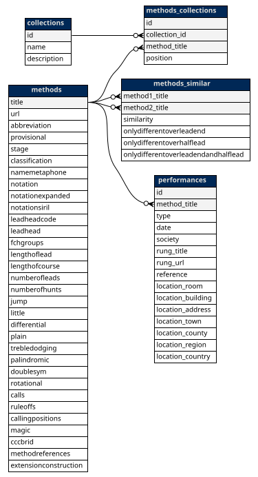

# Data and Copyright

**Purpose:** Record the sources, transformations and storage of Blueline's method, collection and performance data.

**Audience:** Maintainers, contributors and users of the exported data.

**Prerequisites:** None.

You should assume that the output generated by this application is open for use or copying free-of-charge for any purpose. The purpose of creating it is so that it will be useful to bellringers everywhere.

## Database overview

Only the current version of each entity is retained; no record is kept of when data was created or modified (that information may be available at source). The database contains `collections`, `methods`, `methods_collections`, `methods_similar` and `performances`.

The diagram shows the relationships and currently materialised columns for all five exported tables.

- Source: [`assets/images/database.dot`](../assets/images/database.dot)
- Rendered diagram: [`assets/images/database.svg`](../assets/images/database.svg)

The [`/data/{table}.csv` API](api.md#csv-exports) exports these tables. The similarity table is populated by the method-similarity command.

## Methods

Method details are derived from Central Council of Church Bell Ringers (CCCBR) data maintained at [methods.cccbr.org.uk](http://methods.cccbr.org.uk). The [XML schema, part 6](https://cccbr.github.io/methods-library/method_xml_1.0.pdf) is mapped into the `methods` database table.

Source data is not modified. The application adds or computes fields including:

| Field | Description |
| --- | --- |
| `notationExpanded` | Place notation converted to a normalised form: `0`–`9` and uppercase letters for places, `x` for changes with no places made, `.` between consecutive changes with places made, and palindromic abbreviations expanded. See [`PlaceNotation.php`](../src/Helpers/PlaceNotation.php). |
| `notationSiril` | SiRIL notation derived from expanded place notation and stage for clients that consume SiRIL directly. It is a separate representation from `notationExpanded`. |
| `url` | Method title converted to a URL-safe ASCII identifier. |
| `abbreviation` | Manually curated abbreviation where an automatically generated one is unsuitable or clashes with common usage. Overrides are in [`method_extras_abbreviations.php`](../src/Resources/data/method_extras_abbreviations.php). |
| `nameMetaphone` | The method name's metaphone key, used for phonetic search matching. |
| `magic` | Integer used to rank methods for search, calculated from factors including standard-collection membership, classification and how commonly peals are rung. |
| `calls` | Common calls (Bobs and Singles), generated by default and manually overridden where common practice differs. For example, Stedman Triples uses Bobs `5:6:-3` and Singles `567:6:-3`. |
| `callingPositions` | Calling-position names used when displaying calls in compositions and method details; manually set where needed. |
| `ruleOffs` | Lead-display divisions in `[divisionLength]:[start]` form. Defaults to `[leadLength]:0` unless overridden; Stedman, for example, is divided into sixes by `6:-3`. |

The data import is implemented in [`MethodXMLIterator.php`](../src/Helpers/MethodXMLIterator.php) and [`Method.php`](../src/Entity/Method.php). The API field reference documents the serialised fields.

Manual overrides for calls, rule-offs and calling positions are in [`method_extras_calls.php`](../src/Resources/data/method_extras_calls.php). Comments and corrections are welcome.

## Collections

Collection data is maintained manually and reflects common practice in change-ringing. The data is in [`collections.php`](../src/Resources/data/collections.php).

## Performances and renamed methods

Performance records include the date and location of the first known tower-bell and handbell peals of each method. The CCCBR XML schema, part 7 is mapped into the `performances` table.

Renamed methods are also stored in `performances` with `type = 'renamedMethod'`, using [`method_renamed.php`](../src/Resources/data/method_renamed.php) and data from the CCCBR's Methods Library.

## Touches

Touches are generated on the fly by the scripts in [`assets/js/touch_generator/`](../assets/js/touch_generator/); they are not stored in the database or on users' devices. See the [touch-generation guide](touch-generator.md) for behavior and controls.

## Licence and attribution

The repository's [`LICENSE`](../LICENSE) states GNU General Public License version 3 for the code. Package metadata currently reports different licence values; maintainers should reconcile those separately.

**Data licence:** The underlying raw data used by Blueline is derived from the Central Council of Church Bell Ringers (CCCBR) Methods Library. While the CCCBR includes a copyright notice on their official XML/JSON distribution files, the dataset is provided freely to the community. Blueline parses these public method structures into its own internal database format for rendering and analysis.

## Related documentation

- [API reference and CSV schemas](api.md)
- [Development and installation](development-deployment.md)
- [Touch generation](touch-generator.md)
